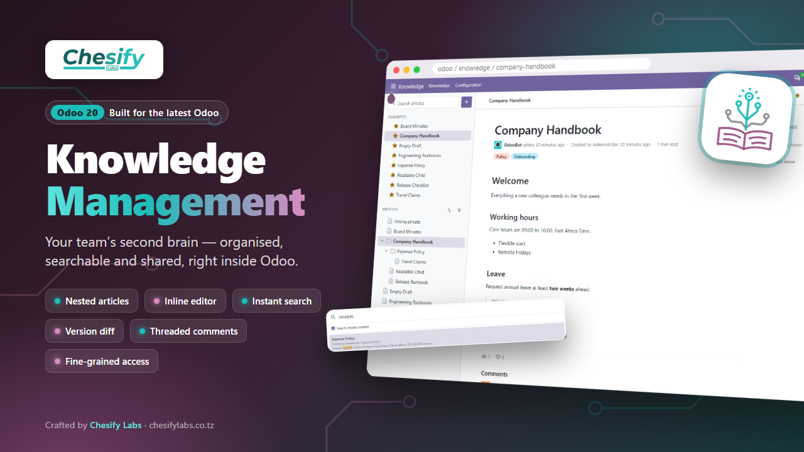
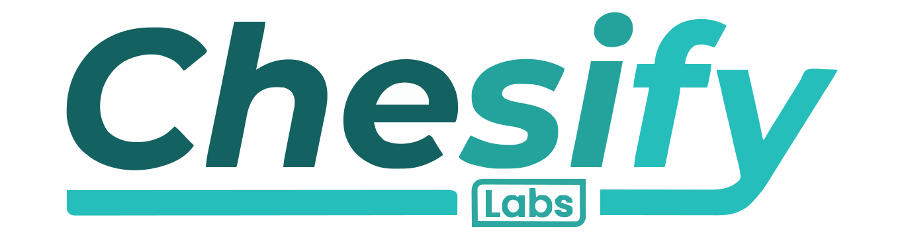

<p align="center">
  
</p>

<h1 align="center">
  
  Knowledge Management
</h1>

<p align="center">
  A modern, Notion-style knowledge base for <b>Odoo 20</b>, built by <a href="http://chesifylabs.co.tz">Chesify Labs</a>.
</p>

<p align="center">
  
  
  
</p>

---

## Overview

**Knowledge Management** (`cl_knowledge_management`) gives your company one
place to write, organise and find everything your team knows, inside Odoo. It
works in Odoo Community and does not need an external wiki.

Articles live in a tree. A handbook can hold policies, the policies can hold
procedures, and each person sees only what they are allowed to see.

## Features

- **Workspace view**: three-pane layout with a resizable, collapsible sidebar
  showing your favourites and the full article tree.
- **Nested articles**: nest pages to any depth and move them anywhere in the
  tree. Moves that would create a loop are blocked.
- **Inline editing**: Odoo 20's rich-text editor right on the page. Type `/`
  for headings, lists, tables, quotes and more.
- **Instant search**: a keyboard-driven palette that searches titles and,
  optionally, content, with highlighted matches.
- **Reading comfort**: breadcrumbs, an automatic "On this page" outline,
  reading time and coloured tags.
- **Version history**: a version is saved on every content change. Compare any
  two versions side by side, or compare a version with the live article.
- **Threaded comments**: discussion with replies under every article.
- **Favourites and likes**: pin articles to your sidebar and see what
  colleagues find useful.
- **Access control**: view and edit rights per article, for everyone, specific
  users or whole departments.
- **Public sharing**: share published articles through a private link that
  needs no login.
- **Chatter and tracking**: standard Odoo chatter on every article.
- **Mobile ready**: the workspace adapts to phones and tablets.

## Requirements

- Odoo **20.0** (tested on Community)
- Dependencies: `base`, `mail`, `web`, `hr`, `html_editor`, all part of
  standard Odoo

## Installation

```bash
# 1. Put the module in one of your addons paths
git clone <repository-url> /path/to/custom_addons/cl_knowledge_management

# 2. Restart Odoo
sudo systemctl restart odoo
```

3. In Odoo, open **Apps → Update Apps List**.
4. Search for **Knowledge Management** and click **Install**.

To upgrade after pulling new code:

```bash
odoo-bin -c /etc/odoo/odoo.conf -d <database> -u cl_knowledge_management --stop-after-init
```

## Quick start

1. Open the **Knowledge** app.
2. Click **+** next to *Search articles* (`Alt+C`) to create an article.
3. Click **Edit** (`Alt+E`), write, and type `/` for blocks. Then click
   **Save** (`Alt+S`).
4. Hover over an article in the sidebar and click **+** to add a
   sub-article.
5. Use **⋯ → Access rights & settings** to choose who can view and edit it.

Full guides are in the [`readme/`](readme) folder:

| File | Contents |
|---|---|
| [DESCRIPTION.md](readme/DESCRIPTION.md) | Features and data model |
| [USAGE.md](readme/USAGE.md) | Day-to-day use: organising, search, comments, versions, sharing |
| [CONFIGURE.md](readme/CONFIGURE.md) | Installation, access rights, tags, public sharing |
| [HISTORY.md](readme/HISTORY.md) | Changelog |

## Access rights

| Who | Can see |
|---|---|
| Everyone | Articles with *View: Everyone* |
| Listed users or departments | Articles they are listed on |
| Author and creator | Always their own articles |
| Settings administrators | All articles |

Department access uses the department on the user's **Employee** record. A new
sub-article copies its parent's rights when it is created. Changing a parent's
rights later does not update existing sub-articles.

## Module structure

```
cl_knowledge_management/
├── controllers/          # JSON-RPC endpoints and the public share page
├── models/               # article, version, view log, tag, category
├── security/
│   └── ir.access.csv     # Odoo 20 access rules (incl. per-article domains)
├── static/
│   ├── description/      # icon, banner, app store page
│   └── src/
│       ├── workspace/    # main OWL client action (sidebar, reader, editor)
│       ├── dialogs/      # search, move, tags, version history
│       ├── comments/     # threaded comments
│       └── public/       # public share page styles
├── views/                # form, list, search, menus, public template
└── readme/               # OCA-style documentation fragments
```

## Known limitations

- Changing a parent's access rights does not update its existing
  sub-articles.
- Every published article has a share link that anyone holding it can open.
  Unpublish an article to disable its link.
- The technical name changed from `i8_knowledge_management`. Databases that
  had the old module installed need a migration to keep their articles.

## Changelog

### 20.0.1.0.0

- Ported to Odoo 20 (OWL 3, `html_editor`, `ir.access`, native `<chatter/>`).
- Renamed from `i8_knowledge_management` to `cl_knowledge_management`.
- New workspace UI, search palette, version diff screen, threaded comments and
  mobile layout.
- Security and stability fixes. See [HISTORY.md](readme/HISTORY.md).

## License

This module is licensed under the
[GNU Lesser General Public License v3.0 (LGPL-3)](https://www.gnu.org/licenses/lgpl-3.0.html).

## Maintainer

<a href="http://chesifylabs.co.tz"></a>

Developed and maintained by **[Chesify Labs](http://chesifylabs.co.tz)**.
For support, customisation or new modules, visit
[chesifylabs.co.tz](http://chesifylabs.co.tz).
